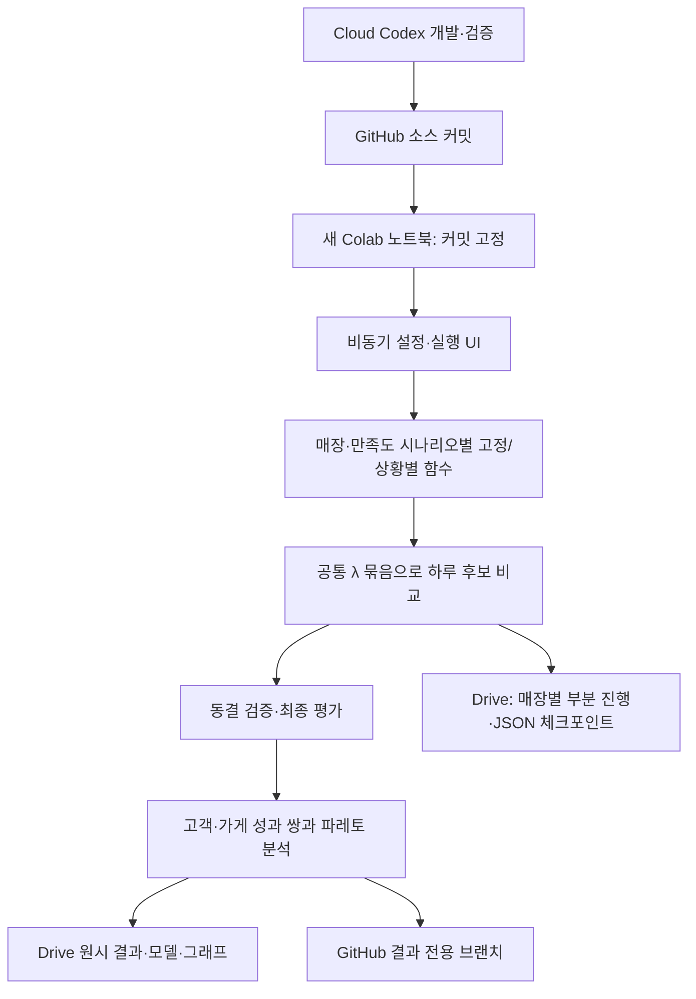

# 실행 구조

실제 실행은 Colab CPU에서 이루어집니다. Codex나 GitHub Actions가 Colab의 장시간 실행을 보장하거나 비공식 API로 세션을 시작하지 않습니다. 원본 매장·고객 생성은 src/kiosk_sim, 새 연구는 src/kiosk_research, 공용 helper는 src/kiosk_cloud입니다.

각 매장의 시뮬레이션 상태는 모델·만족도 시나리오·λ별로 독립적이며 같은 외생 난수를 공유합니다. 매일 모든 매장을 완료한 뒤 날짜를 진행합니다. 체크포인트는 JSON 상태와 일별 Parquet 해시 목록을 저장합니다. 재개는 동일한 코드·커밋·설정·Python/라이브러리 버전을 요구합니다.
