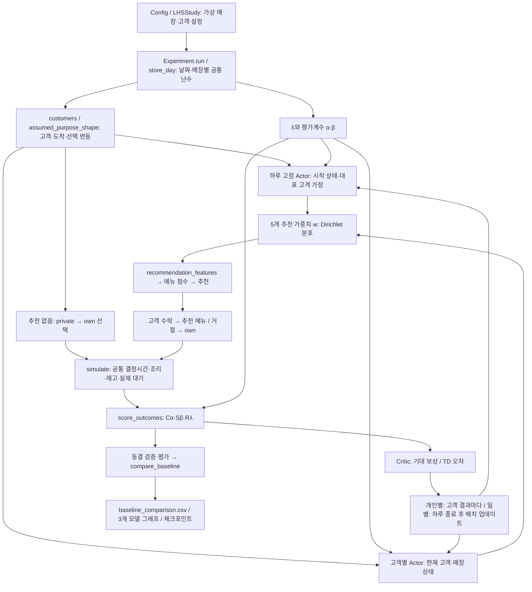

# 일반 고객 선택과 두 신경망의 비교

새 기본 설정은 `models: [no_recommendation, fixed, contextual]`, `decision_time_mode: equal`이다. 이전 603일 실험은 시간 가정과 비교군이 다르므로 기존 결과와 합치지 않는다. 원래 커밋·실험 ID의 결과는 보존하고 새 실험을 생성한다.

## 고객의 일반 선택

`simulate()` 내부의 `private()`와 `own`을 그대로 재사용한다. 구매 가능한 메뉴 중 아래 효용이 가장 높은 것을 고른다.

`U = 2.5 × affinity − price_sensitivity × price/20 − wait_sensitivity × predicted_wait/30 + 0.16 × log(G)`

`G ~ Gamma(1,1)`은 고객·메뉴별 일회성 선택 변동이다. 계수와 행동 모형은 기존 합성 가정이며 실제 고객 행동을 검증한 값이 아니다. 추천 없음은 제안 메뉴·수락 판정·신경망을 사용하지 않는다. 폐기 위험과 매장 이익을 고객의 자기 선택 효용에 직접 넣지 않는다. AI 조건에서는 같은 자기 선택을 추천 거절 시 사용한다.

세 방식 모두 탐색·결정시간을 `1.3 + 0.45 × 현재 구매 가능한 메뉴 수`분으로 계산한다. 동일한 메뉴 수에서 추천 수락·거절·추천 없음에 따른 시간 보너스나 페널티가 없다. 이전 주문으로 재고·가능 메뉴가 달라진 이후에는 실제 선택의 결과로 시간과 조리 대기가 달라질 수 있다. 위 시간식 자체는 실측이 아닌 공통 실험 가정이다. 추천 특징의 예상 대기 계산에도 같은 결정시간을 사용한다.

## 함수와 흐름

각 AI는 별도의 Actor와 Critic을 가진다. Actor는 25→16→16→5의 농도 출력을, Critic은 25→16→16→1의 가치 출력을 갖는다. `λ`는 고객 성과와 매장 성과의 비중이며, 추천 가중치 5개 및 고정 평가계수 α·β와 구별한다. 추천 없음은 보상을 평가받지만 파라미터를 학습하지 않으며 가중치 함수·수렴 검사 대상에서 제외된다.

## λ 비교

아래는 기존 고정 프로토콜의 기록이다. 새 기본값은 [파레토 2단계 탐색](pareto_two_stage_ko.md)이며 넓은 학습과 구간 선택 검증에서는 0·0.5·1, 집중 학습에서는 선택한 세 값과 주기적 전역 확인을 사용한다. 최종 검증 5개·평가 9개는 유지한다.

- 학습: 기본 3개. `0`, `1`, 매일 새로 뽑는 `Uniform(0,1)` 중간값 하나. 매장·모델 간 같은 날짜의 λ를 공유한다.
- 동결 검증: `0, .25, .5, .75, 1`의 5개.
- 동결 최종 평가: `0, .125, .25, .375, .5, .625, .75, .875, 1`의 9개.

각 λ 실행은 하루의 반사실적 복제이며 하루 안에서 λ를 연달아 바꾸는 것이 아니다. 동일한 초기 재고·고객·도착·메뉴 선택 변동·수락 난수를 사용한다. 추천 없음의 실제 행동은 λ와 α·β에 의존하지 않지만 같은 결과를 각 기준으로 채점한다. 추천 모델은 λ별 가중치가 달라져 행동도 바뀔 수 있다.

## 성능 향상 판정과 파일

완료된 평가 주기에서 같은 날짜·매장·기준·λ의 AI 결과와 추천 없음 결과를 일대일로 짝지어 `baseline_comparison.csv`에 저장한다. 고객·매장·공통 보상, 이익, 실제 대기시간, 남은 재고 등의 절대 차이와 상대 개선량을 기록한다. 대기·남은 재고는 감소를 개선으로 표시한다. 기준값 0에서는 상대 개선율을 비워 두어 0으로 나누지 않는다.

독립 반복 5회 이상일 때만 반복 단위 paired bootstrap 95% 구간을 계산한다. 연속 학습 주기는 독립 반복으로 취급하지 않으며 기술통계만 표시한다. 작은 양의 차이나 신뢰구간만으로 실무적 효과를 단정하지 않는다. 의미 있는 최소 개선량은 이익·대기·폐기 등 운영 단위에서 별도로 정해야 한다.

`live/index.html`에는 추천 없음(초록), 하루 고정(파랑), 고객별(분홍)의 선이 함께 나온다. 마지막 날짜가 일부 매장만 반영하면 임시값이다. 날짜마다 고객·재고가 바뀌는 학습 곡선을 인과적 학습 효과로 해석하지 않는다.

코랩은 GitHub 저장소의 정확한 커밋을 읽고, Drive에 결과를 저장한다. 코드 변경은 GitHub 커밋에서 비교할 수 있다. 학습 중 신경망은 체크포인트로 저장되며 자동으로 GitHub 코드를 변경하지 않는다. 원시 결과를 공개 저장소에 자동 업로드하지 않는다.
