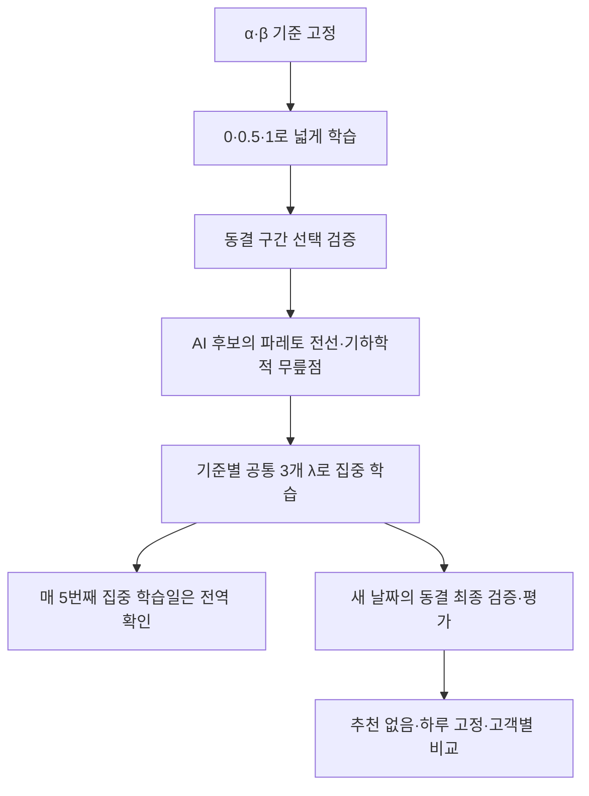

# α·β별 파레토 2단계 λ 탐색

새 신경망 기본 설정은 `lambda_search: pareto_two_stage`다. 추천 없음·하루 고정 AI·고객별 AI의 세 비교군과 동일 결정시간 공식은 유지한다. 기존 실험과 섞지 않으며 새 실험 ID와 스키마 7 체크포인트를 사용한다.

## 실행 순서와 예산

| 구간 | 연구·누적 설정 | pilot | 실행 내용 |
|---|---:|---:|---|
| 넓은 학습 | 10일 | 1일 | λ=0, 0.5, 1로 학습 |
| 구간 선택 검증 | 5일 | 1일 | 두 AI를 동결하고 같은 검증 고객·환경에서 세 λ를 비교 |
| 집중 학습 | 10일 | 1일 | 선택한 세 λ로 이어 학습; 매 5번째 집중 학습일은 0,0.5,1로 전역 확인 |
| 최종 검증 | 5일 | 1일 | 새로운 날짜에서 동결, λ=0,.25,.5,.75,1 |
| 최종 평가 | 5일 | 1일 | 별도의 새로운 날짜에서 동결, λ=0,.125,…,1 |

연구·누적 주기는 총 35일이며 실제 학습일은 20일이다. pilot은 총 5일이고 실제 학습일은 2일이다. `train_days`는 두 학습 구간의 합이다. `coarse_train_days`를 비우면 절반(내림)을 1단계에 배분한다. `validation_days`는 구간 선택과 최종 검증에 각각 적용된다. `research`는 5개의 독립 반복, `continual`은 신경망을 이어가는 의존 주기다.

## 구간을 정하는 방법

각 α·β 기준 안에서만 계산한다. 매장별로 구간 선택 검증 날짜의 C와 S를 평균한 뒤 매장들을 동일 비중으로 평균한다. 하루 고정·고객별 AI의 λ별 후보를 함께 모아 다른 후보에 지배되는 점을 제외한다. 추천 없음은 이 선택의 입력으로 사용하지 않으며 최종 비교 기준으로 남긴다.

남은 파레토 후보를 C 순서로 정렬한다. C·S는 이미 [0,1] 범위이므로 표본별 최소·최대 재정규화를 하지 않는다. 양 극단을 연결한 선분보다 (1,1) 방향으로 가장 많이 돌출된 내부 후보를 기하학적 무릎점 후보로 선택한다. 두 목적의 고정된 단위 범위에서 수직 거리를 사용하며, Rλ의 크기를 서로 비교하거나 이차 다항식의 극값을 구하지 않는다.

- 선택 λ가 0.5이면 집중 목록은 0.25, 0.5, 0.75다.
- 선택 λ가 0이면 0, 0.25, 0.5, 선택 λ가 1이면 0.5, 0.75, 1이다.
- 서로 다른 파레토점이 세 개 미만이거나 내부 돌출점이 없으면 `no_clear_knee_keep_global`을 기록하고 0, 0.5, 1을 유지한다. 영 방문자이면 전역 목록을 유지한다.

하나의 평가기준 안에서 세 비교군은 같은 λ 목록과 같은 고객·초기 재고·외생 난수를 쓴다. 두 AI가 서로 다른 λ 예산을 받지 않도록 공통 구간을 사용한다. 어떤 AI가 후보 선택을 이끌었는지는 후보의 model 필드에 남는다.

기하학적 무릎점은 절충을 탐색하는 명시적 규칙이다. 유일한 사회적 선호점이나 전역 최적점을 보장하지 않는다. 표본이 적으면 잡음에 민감할 수 있으므로 검증을 여러 날짜에 반복하고 전역 확인도 유지한다. α·β를 바꾼 서로 다른 기준의 점수는 한 전선으로 섞지 않는다.

## 누출 방지·재개·출력

구간 선택에는 1단계 뒤의 `search_stage=selection`, `phase=validation` 데이터만 쓴다. 최종 평가 날짜나 최종 검증 날짜를 보고 탐색 구간을 변경하지 않는다. 보고서의 검증 요약에는 집중 학습 후의 최종 검증만 들어간다. 1단계 점수와 2단계 점수의 차이는 학습량·고객 날짜도 달라지므로 인과적인 학습 개선으로 해석하지 않는다. 모델 비교는 같은 최종 평가 날짜에서 수행한다.

선택한 목록과 근거는 체크포인트의 `lambda_search` 및 `experiments/실험ID/lambda_search/cycle_XXXX.json`에 저장한다. 재개 시 저장된 목록을 그대로 사용한다. 결과 행에는 `search_stage`, `lambda_schedule`, 실제 `lambda_value`가 기록된다. 최종 보고서에는 `lambda_search.json`, `lambda_schedule.csv`, `baseline_comparison.csv`가 포함된다. 실시간 화면에는 현재 단계와 기준별 집중 λ 목록이 표시된다.

추천 없음 대비 비교는 같은 최종 날짜·매장·평가기준·λ끼리 짝지은 C, S, R, 이익, 대기, 재고 등의 차이다. 추천 없음은 신경망이나 추천 가중치를 학습하지 않는다. 의존적인 누적 주기를 독립 반복으로 취급하지 않으며 신뢰구간을 붙이지 않는다.

주요 함수: `Config.search_stage()`가 일정을 구분하고, `select_plan()`이 검증 후보로 계획을 만들며, `training_grid()`가 해당 날짜의 세 λ를 반환한다. `Experiment`는 계획을 보존·재개하고 `store_day()`는 전달받은 목록으로 시뮬레이션한다. `compare_baseline()`은 최종 추천 없음 대비 차이를 계산한다.

## 검증 기록

2026-10-29 KST: 기존 기능을 포함한 61개 로컬 검사가 통과했다. 단계별 학습일 계산, 검증 데이터만 사용하는 구간 선택, α·β 기준 분리, 추천 없음 제외 후 후보 선택, 세 비교군의 동일 집중 목록, 주기적 전역 확인, 선택 계획 보존과 정확한 재개, 최종 검증에서 구간 선택 자료 제외를 확인했다.

5일 로컬 pilot은 552행, 비교 CSV와 그래프·계획 파일을 저장했다. 이 짧은 학습의 실제 검증 후보는 서로 같아서 `no_clear_knee_keep_global`을 기록하고 전역 목록을 유지했다. 통제된 테스트에서는 돌출된 무릎점 후보가 있을 때 0.25·0.5·0.75로 좁혀지는 것과 실제 worker가 이 목록을 세 비교군에 적용하는 것을 확인했다. 이 기록은 새 조건의 Colab 장기 실행 완료나 성능 향상을 의미하지 않는다.
