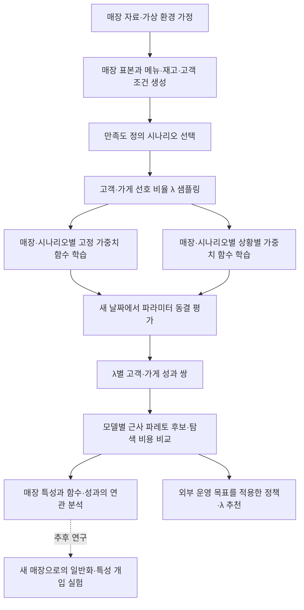
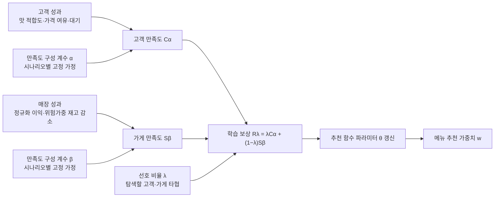
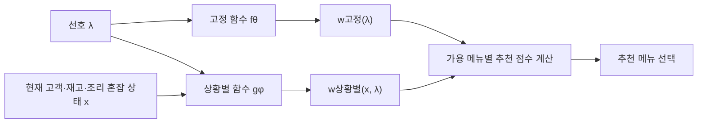
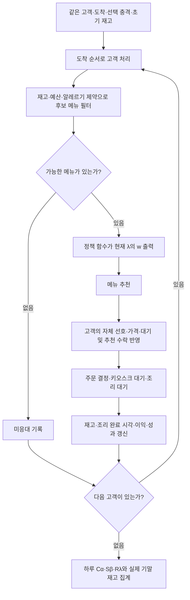
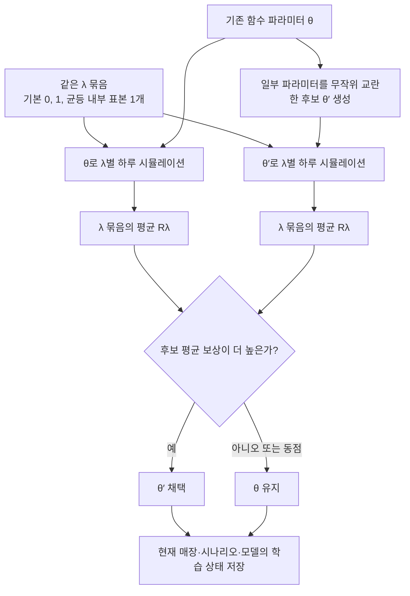
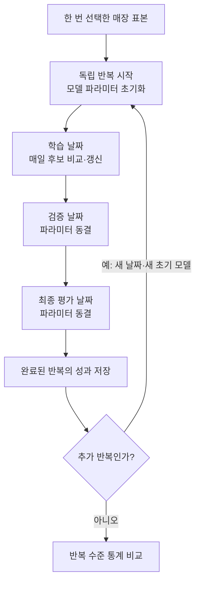
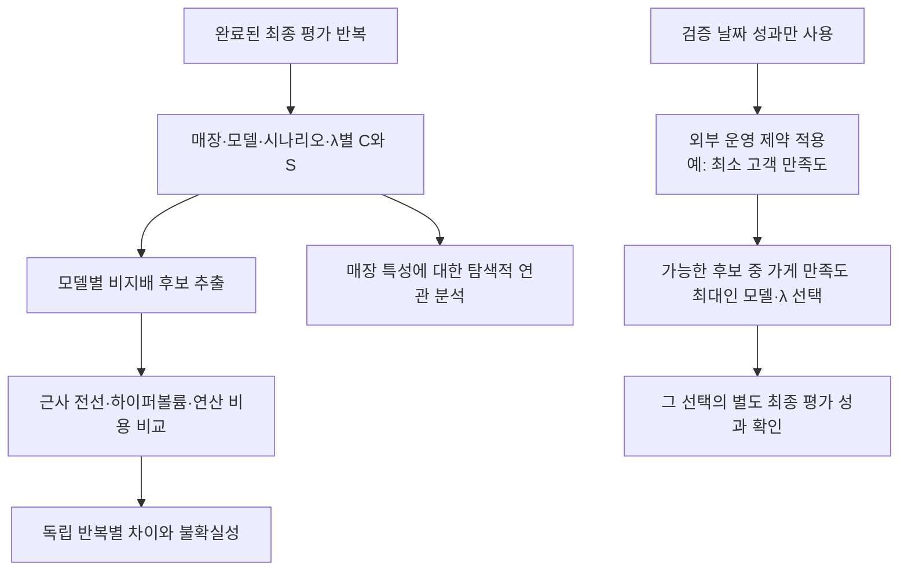
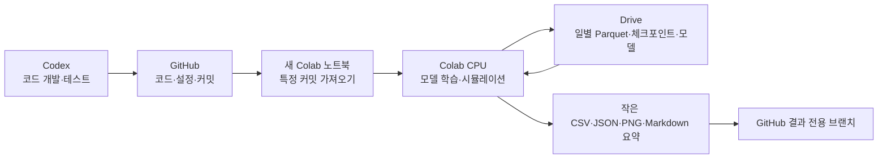
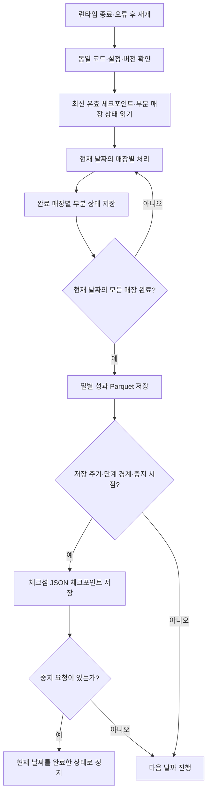

> 후속 구현: 9개 기준·교차평가·자동 저장 정리는 [자동 실행 안내](automatic_colab_ko.md)를 참고하세요. 아래의 미구현/미푸시 표시는 해당 문서 작성 당시의 기록입니다.

# 시뮬레이션 구조: 연구 구상과 현재 구현

작성 기준: 2026-10-26, schema 3 (함수 점검 반영). 이 문서는 현재 코드와 이후 연구 목표를 구분합니다. 아래 설정값은 변경할 수 있는 기본안이며 연구의 최종 가정으로 확정한 값이 아닙니다.

전체 흐름 그림: [SVG 확대](simulation_structure.svg) · [PNG](simulation_structure.png). Graphviz 원본은 simulation_structure.dot이며 `dot -Tsvg`로 다시 생성할 수 있습니다.

## 1. 연구의 전체 흐름

목표는 단일 종합점수의 승자를 정하는 것이 아니라, 같은 연산 예산에서 어떤 방식이 어떤 매장·만족도 가정에서 좋은 타협점들을 찾는지 확인하는 것입니다. 최적성을 보장하는 해석적 함수나 인과관계를 이미 증명한 것은 아닙니다.

## 2. 서로 다른 세 가중치

- **α, β**는 만족도를 어떻게 정의할지 정합니다. 모델이 이를 바꾸지 못합니다. 실제 피드백으로 추정하기 전에는 가정입니다.
- **λ**는 정의된 두 만족도 사이에서 무엇을 더 중시할지 나타냅니다. λ=0.8이 고객 만족도 80점을 보장한다는 뜻은 아닙니다.
- **w**는 메뉴를 고를 때 적합도·재고 위험·마진·대기를 얼마나 반영할지 나타내는 정책 출력입니다.

현재 고객 만족도는 세 구성요소의 가중합입니다. 각 구성요소 합계를 전체 방문자 수로 나누어 미응대 고객은 0으로 처리합니다. 가게 만족도는 두 구성요소의 가중합입니다. 위험가중 재고 감소는 실제 폐기 손실을 관측한 값이 아닌 대리 지표입니다.

현재 가정 예시:

| 시나리오 | 고객: 맛·가격·대기 | 가게: 이익·재고 감소 |
|---|---|---|
| balanced | 0.45 / 0.25 / 0.30 | 0.75 / 0.25 |
| time_sensitive | 0.25 / 0.15 / 0.60 | 0.75 / 0.25 |
| waste_sensitive | 0.45 / 0.25 / 0.30 | 0.40 / 0.60 |

이는 추정된 실제 선호가 아닙니다. 시나리오 간 점수를 같은 효용으로 간주해 순위를 매기지 않습니다. 한 시나리오 안에서는 고객마다 취향·예산·민감도 등이 다르지만, 평가용 α·β를 각 개인의 설문으로 학습한 구현은 아닙니다.

## 3. 학습 대상: λ를 입력받는 추천 함수

매장 i와 만족도 시나리오 s마다 별도의 파라미터를 둡니다.

`w고정 = fθ(i,s)(λ)`

`w상황별 = gφ(i,s)(x,λ)`

**고정**은 λ까지 고정했을 때 고객이나 운영 상태에 따라 w가 바뀌지 않는다는 뜻입니다. λ를 바꾸면 고정 모델의 w도 바뀔 수 있습니다.

현재 함수는 λ의 이차 기저 `b(λ)=[1,2λ−1,(2λ−1)²]`와 softmax를 사용합니다.

- 고정: `softmax(Θ b(λ))`, 5×3=15개 파라미터.
- 상황별: `softmax(Φ [h(x)⊗b(λ)])`, 상수항을 포함한 9개 상황 특성으로 5×27=135개 파라미터.
- 출력 다섯 가중치는 음수가 아니며 합이 1입니다.

여러 λ를 하나의 함수로 함께 학습합니다. 각 λ에서 독립적으로 최적화한 뒤 함수를 맞추는 방식은 아직 기준선으로 구현하지 않았습니다. 따라서 출력은 학습으로 찾은 후보 가중치이며 λ별 전역 최적 가중치라는 보장은 없습니다.

## 4. 매장 하루 안의 고객 처리

각 모델·후보·λ·시나리오에는 같은 외생 고객 조건을 주지만 추천 행동 이후의 재고와 대기는 독립적입니다. 가게 간 재고나 학습 파라미터를 공유하지 않습니다. 매일 초기 매장 템플릿에 재고 변동을 적용해 다시 시작하며, 현재는 전날 재고 이월과 발주 최적화를 모델링하지 않습니다.

## 5. 하루 단위 함수 학습

고정·상황별 모두 같은 paired random search와 동일 호출 예산을 사용합니다. 같은 λ 묶음의 평균 보상을 높이는 공동 최적화이며 각 λ의 보상을 모두 개별적으로 개선한다는 뜻은 아닙니다. 두 모델의 차원과 계산시간은 다릅니다. 현재 학습은 신경망 역전파, LinUCB, 톰프슨 샘플링이 아닙니다.

## 6. 전체 반복 실험과 동결 평가

실측 예시 설정은 매장 64개, 학습 40일, 검증 5일, 최종 평가 10일, 독립 반복 5회입니다. 총 275개의 동기화된 날짜입니다. **학습을 275일 내내 이어가는 구조가 아니며**, 각 반복에서 모델을 초기화합니다. 실제로 이 규모를 실행했다고 주장하는 것은 아닙니다.

검증 λ 기본 5개, 최종 평가 λ 기본 9개입니다. 초기 균등 정책도 같은 평가 날짜에서 함께 실행하여 학습 전후를 비교합니다. 초기 정책 결과로 학습 모델을 다시 갱신하지 않습니다. 최종 평가 λ에 검증 λ를 포함해 선택 정책의 별도 성과를 확인합니다.

학습·검증·평가의 날짜는 다르지만, 검증과 최종 평가에서 일부 λ는 같습니다. 완전히 낯선 선호 분포로의 일반화가 아닌 날짜 분리 및 λ 보간 평가입니다. 반복은 매장 표본을 고정한 조건부 반복이며 모집단 매장 표집 불확실성을 모두 반영하지 않습니다.

## 7. 분석과 운영 목표에 따른 선택

한 점을 다른 점이 고객·가게 양쪽 모두에서 같거나 더 좋고 적어도 하나에서 더 좋게 만들 수 없으면 비지배 후보로 남깁니다. 전선은 모델별·만족도 시나리오별로 계산합니다. 서로 다른 만족도 정의의 전선을 하나로 섞지 않습니다.

하이퍼볼륨은 [0,1] 두 만족도에서 기준점 (0,0)을 고정합니다. 5회 미만 반복은 기술통계만, 5회 이상은 반복 단위 paired bootstrap 구간을 계산합니다. 5회라는 수가 충분한 연구 증거를 보장하지는 않습니다. 실제 통계 검정력과 표본 설계는 별도로 검토해야 합니다.

가게 특성 분석은 λ·모델·시나리오별 성과에 대한 표준화 ridge 회귀와 donor-group 교차검증입니다. 탐색적 연관이며 매장 특성의 인과효과나 신규 매장 정책 일반화를 증명한 것은 아닙니다.

## 8. 코드·실험·데이터의 위치

Codex에서도 기능 검증용 가상 실험을 실행할 수 있지만, 사용자 연구의 장시간 연산은 Colab을 기본으로 합니다. Google 계정 로그인·Drive 마운트·Colab Secrets는 사용자 계정에서 승인합니다. GitHub를 통해 코드를 가져오는 것이 Codex가 Colab 런타임을 자동 조작할 수 있다는 뜻은 아닙니다.

## 9. 안전 중지와 복구

중지 버튼은 현재 날짜의 모든 매장 완료 후 처리합니다. 완료된 부분 결과를 재사용해 중복 학습을 방지합니다. 체크포인트와 일별 샤드는 체크섬으로 검증하고 이전 유효 세대로 복구할 수 있습니다. Drive의 분산 잠금·동기화를 완전히 보장하는 것은 아니므로 하나의 실험은 하나의 런타임에서만 실행합니다.

## 10. 실험 크기와 비용

방문자 수가 양수인 매장만 있다고 가정하면 호출 수는 다음과 같습니다.

`반복 × 매장 × 만족도 시나리오 × 모델 × [2×학습일×학습λ수 + 2×검증일×검증λ수 + 2×평가일×평가λ수]`

학습의 2는 기존 함수와 후보 함수, 검증·평가의 2는 학습된 정책과 초기 균등 정책입니다. 평가 기록 행 수는 각 λ당 선택 정책의 행 하나이므로 호출 수와 같지 않습니다.

64매장·3시나리오·2모델·40/5/10일·3/5/9 λ·5반복 예시는 **902,400번의 매장 하루 시뮬레이션**입니다. 각 호출은 해당 매장의 방문자 전체를 처리합니다. 매장당 고객 1명을 처리하는 902,400회가 아닙니다. 사전 소규모 시간 측정 없이 이 규모를 바로 실행하지 않습니다. 방문자 0 매장은 후보 학습을 생략하므로 호출 수가 다를 수 있습니다.

## 11. 구현·검증 범위와 다음 연구

| 항목 | 현재 상태 |
|---|---|
| λ 조건부 고정/상황별 함수 | 구현, 매장·시나리오별 독립 파라미터 |
| 만족도 계수 민감도 | 가정 시나리오로 구현; 실제 선호 추정 아님 |
| 동일 학습 보상·호출 예산 | 구현; 같은 시간·난이도 보장 아님 |
| 동결 검증·최종 평가 | 구현 |
| 파레토 후보·반복 분석 | 구현; 전역 최적성 보장 아님 |
| 매장 특성 연관 분석 | 구현; 인과 규명 아님 |
| 운영 제약 기반 λ 선택 | 구현; 객관적 유일 최적 λ 아님 |
| 각 λ별 독립 최적화 기준선 | 다음 비교 과제 |
| 매장 특성 z를 입력하는 통합 함수 F(z,x,λ) | 다음 연구; 현재 매장별 함수로 대신 구현 |
| 매장 특성의 효과를 분리하는 개입 실험 | 다음 연구 |
| 실제 고객/운영자 피드백으로 만족도 추정 | 추가 자료 필요 |
| 실제 Colab·Drive 인증 및 대규모 KREI 실험 | 사용자 계정에서 별도 검증 필요 |

관련 코드: `config.py`, `policy.py`, `simulation.py`, `worker.py`, `engine.py`, `analysis.py`, `persistence.py`, `ui.py` (모두 `src/kiosk_research/`).

2026-10-26 변경: 추천 출력에 가격 여유를 추가하고 다섯 특성을 0~1로 정규화했습니다. 평가 전용 모듈과 매장별 HV 통계, 검증 자료 선택 보호를 추가했습니다. 상세 공식 및 한계는 [연구 방법](research_methodology_ko.md)의 schema 3 절을 참고하세요.
